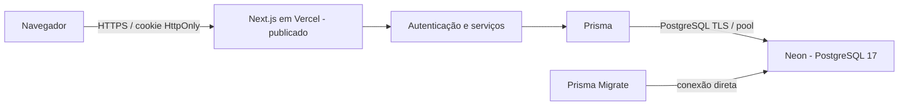

# Arquitetura e decisões

Monólito modular: Next.js 16 App Router, React, TypeScript estrito, Tailwind 4, Prisma 6.19.3 e PostgreSQL 17. Prisma 6 foi fixado para usar cliente e migrations compatíveis; as dependências transitivas deepmerge-ts e minimatch possuem overrides para versões corrigidas, validadas com build e testes.

- `src/lib/domain.ts`: validação Zod, estados e regras puras.
- `src/lib/service.ts`: autorização atual no servidor, transações e persistência Prisma.
- `src/lib/auth.ts`: bcrypt custo 12, token aleatório de 256 bits, somente SHA-256 do token no banco, expiração absoluta de oito horas, logout com revogação.
- `src/app/api/[...path]/route.ts`: operações JSON POST, origem validada, limites de payload, erros públicos genéricos.
- `src/app/(protected)`: T02–T08, renderização no servidor e autenticação em cada página. T01 fica em `/login`.

Ambientes validados: Next.js local com PostgreSQL 17 em Docker e produção Vercel com Neon. URL pública: https://helpdeskiweti.vercel.app. Dois testes Playwright publicados comprovaram o fluxo UI → API → Neon → UI, cookie Secure e bloqueio CSRF.

## Preservação dos PDFs

Foram lidos os três PDFs fornecidos em Downloads. A versão 2 prevalece sobre a concepção inicial. O PDF de implantação deixa tecnologias em aberto, portanto Next.js/Vercel/Neon são decisões desta implementação.

As RN01–RN06 são aplicadas no backend: criação com histórico, atribuição única, propriedade por técnico, solução e encerramento separados, bloqueio após fechado e versão otimista. As migrations acrescentam FKs, checks e triggers diferidas para histórico obrigatório e solução obrigatória em Solucionado/Fechado.

A atribuição bloqueia a linha da conta técnica; a administração usa o mesmo bloqueio ao desativar ou mudar perfil. A alteração do chamado compara `id + version` e incrementa a versão, em transação com solução/histórico. Conflitos retornam HTTP 409. Relatórios usam snapshot Repeatable Read.

## Políticas explicitadas

- Técnico pode consultar todos os chamados, com filtros disponíveis/meus, mas altera apenas os próprios.
- Fuso civil: America/Sao_Paulo, UTC-03 nas datas contemporâneas do projeto; fim exclusivo no dia seguinte, incluindo todo o último dia. Não há suporte histórico às mudanças de horário de verão anteriores a 2019.
- Título 3–160 caracteres, descrição 10–10.000, solução 1–10.000; senhas 12–72 caracteres no cadastro. Critérios técnicos acrescentados e visíveis nos formulários.
- E-mails normalizados em minúsculas; desativação preserva contas e autoria. Edição de conta revoga sessões existentes.
- Categoria é catálogo inicial, sem administração de categorias nesta versão.
- Listagem limitada explicitamente a 200 registros filtrados; relatórios consideram todo o conjunto.
- Sem anexos, reabertura, notificações, SLA ou integrações externas, conforme PDF.
- Sem recuperação de senha nesta versão. Seed não redefine senhas de contas já existentes.

## Limites de segurança e operação

HTTPS e cookie Secure foram verificados na produção; local usa HTTP. O projeto ainda não tem limitação distribuída de tentativas de login, recuperação de senha nem rotina agendada de limpeza de sessões expiradas. Antes de uso com dados reais, definir essas políticas e executar avaliação de segurança. Os dados atuais são fictícios e as contas de demonstração devem ficar isoladas.

## Atualização de infraestrutura

Foi criado o projeto Neon `helpdesk-best-project` (`rough-bread-02478903`), região us-east-1, PostgreSQL 17, branch `demo` isolada. Schema e seed foram aplicados em conexão TLS real. Credenciais em `.env.cloud`, ignoradas por Git. A CLI Vercel autenticada como Owner concluiu o deploy de produção, após autorização explícita para configurar as URLs Neon como segredos. O domínio https://helpdeskiweti.vercel.app foi validado por testes reais.
